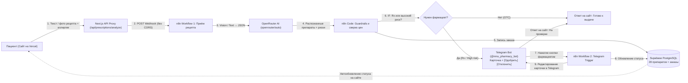

# ФармаКонтроль — Автоматизация аптеки и проверки рецептов

Учебный проект по курсу **Generative AI · ISE MNU · Fall 2026** (*Pharmacy & Prescription Management*).

- **Живой сайт:** https://pharmacy-prescription-management.vercel.app/
- **Telegram-бот фармацевта:** [@mnu_pharmacy_bot](https://t.me/mnu_pharmacy_bot)
- **Сценарии автоматизации:** папка `n8n/` (`workflow-analyze-prescription.json`, `workflow-pharmacist-approval.json`)

---

## 1. Краткое описание бизнеса (Short Business Description — 1 страница)

### Что делает сервис
**ФармаКонтроль** — цифровой помощник для современной аптеки, который автоматизирует приём и первичную проверку врачебных рецептов. Вместо того чтобы фармацевт вручную расшифровывал назначения, искал препараты по базе, подбирал дженерики и вспоминал возможные противопоказания, система делает это за ~10 секунд с помощью ИИ и передаёт фармацевту уже готовую структурированную карточку на финальное одобрение.

### Для кого этот продукт
1. **Пациенты** — могут заранее загрузить текст или фото рецепта с телефона или компьютера, сразу узнать наличие и точную стоимость в тенге (`₸`), получить аналог при отсутствии оригинала и понятную памятку по приёму.
2. **Фармацевты и аптечные сети** — сокращают время обработки одного рецепта в 3–5 раз, снижают риск человеческой ошибки при аллергиях и лекарственных взаимодействиях и подтверждают отпуск рецептурных препаратов (`Rx`) одной кнопкой прямо в Telegram.

### Как помогает автоматизация
- **Без очередей и ручного ввода:** пациент отправляет рецепт через веб-форму, а заказ автоматически появляется в базе аптеки.
- **Снижение упущенных продаж:** если нужного бренда нет на складе (например, *Нурофен Форте* или *Амоксиклав*), система сама предлагает реальный аналог из остатков по действующему веществу (*Ибупрофен* или *Аугментин*).
- **Безопасность (Human-in-the-Loop):** ИИ никогда не отпускает рецептурные (`Rx`) или опасные назначения самостоятельно — при наличии рецептурных препаратов или конфликта с аллергией заказ блокируется на проверке и мгновенно отправляется живому фармацевту в Telegram.

---

## 2. Схема архитектуры (Workflow Architecture Diagram)



### За что отвечает каждый сервис (простыми словами для защиты)

| Сервис | Роль в проекте | Что говорить преподавателю |
|---|---|---|
| **Vercel** (`Next.js`) | Сайт + защитный прокси | Здесь живёт сам сайт (3 вкладки: *Рецепт*, *Заказы*, *Склад*, светлая и тёмная темы, адаптив под телефон). Серверные роуты `/api/*` принимают запросы от браузера и сами ходят в `n8n` и `Supabase` — благодаря этому нет ошибок CORS, ключи скрыты от браузера, и есть резервный вызов ИИ на случай сбоя `n8n`. |
| **n8n** (`ai2.mnu.kz`) | Мозг автоматизации | Университетский сервер, где крутятся 2 опубликованных workflow. **Workflow 1** принимает рецепт с сайта, вызывает ИИ, перепроверяет цены, сохраняет заказ в базу и шлёт карточку фармацевту в Telegram. **Workflow 2** ловит нажатие кнопки в Telegram (или на сайте), обновляет статус заказа в базе и меняет текст сообщения в Telegram. |
| **OpenRouter** (`openrouter/auto`) | Искусственный интеллект | Понимает произвольный русский текст и фото бланков рецептов (Vision), извлекает названия, дозировки и курс в строгий JSON, находит конфликты с аллергиями/взаимодействиями (например, *Пенициллин + Амоксициллин* или *Варфарин + Ибупрофен*) и подбирает аналоги со склада. |
| **Supabase** (`PostgreSQL`) | База данных аптеки | Хранит таблицу `medications` (28 реальных препаратов с ценами в `₸`, остатками и пометкой `Rx`/`OTC`) и таблицу `orders` (все заказы и статусы). Включён `Row Level Security (RLS)` — напрямую из браузера базу прочитать нельзя, только с сервера по `service_role`. |
| **Telegram** (`@mnu_pharmacy_bot`) | Рабочий пульт фармацевта | Мгновенно присылает карточку рецептурного заказа на телефон фармацевта с кнопками `✅ Одобрить заказ` и `❌ Отклонить`. После нажатия кнопки пропадают, статус обновляется в базе и сам перекрашивается на сайте. |

---

## 3. Как мы закрываем все критерии оценки (Шпаргалка на 100 баллов)

### 1. n8n Automation — Functionality (20 баллов)
*Что проверяют:* работают все 5 задач, триггеры срабатывают, данные проходят между узлами.

**Наши 5 автоматических задач в n8n:**
1. **Приём и парсинг рецепта (Webhook → OpenRouter):** извлечение препаратов, дозировок и схемы приёма из текста или фото в структурированный JSON.
2. **Проверка склада и подбор аналогов (Code Node + каталог из 28 препаратов):** проверка реального наличия, расчёт суммы в `₸` и подбор доступного дженерика по действующему веществу, если оригинала нет на складе (6 готовых пар, например *Нурофен Форте → Ибупрофен*, *Амоксиклав → Аугментин*, *Но-шпа → Дротаверин*).
3. **Проверка безопасности (AI Guardrails):** выявление аллергических конфликтов (*Пенициллин + Амоксициллин*) и лекарственных взаимодействий (*Варфарин + Ибупрофен*) с уровнем риска `high / medium / low`.
4. **Сохранение заказа в базу (Supabase REST API):** автоматическая запись заказа с уникальным кодом `RX-XXXX` и маршрутизация статуса (`pending_approval` для `Rx`/рисков или `ready_for_pickup` для безопасных `OTC`).
5. **Подтверждение фармацевтом (Telegram Bot + Telegram Trigger):** отправка карточки с inline-кнопками фармацевту → при нажатии кнопки срабатывает второй workflow, который обновляет статус заказа в Supabase, убирает всплывающую загрузку (`answerCallbackQuery`) и редактирует сообщение в Telegram.

### 2. n8n Automation — Integration Complexity (20 баллов)
*Что проверяют:* разнообразие интеграций, реальное использование ИИ, логика ветвления.
- **5 реальных интеграций в одной связке:** Веб-сайт (`Webhook`) + `OpenRouter AI` (текст и фото) + `Supabase` (`POST`/`PATCH`) + `Telegram Bot` (отправка и редактирование сообщений) + `Telegram Trigger` (обработка callback-кнопок).
- **Умная логика внутри n8n:** узел `IF` разделяет рецептурные/опасные заказы (уходят фармацевту в Telegram) и обычные безрецептурные `OTC` (сразу готовы к выдаче); Code-ноды очищают JSON от мусора и программно пересчитывают цены строго по каталогу.

### 3. Landing Page / Web App (20 баллов)
*Что проверяют:* качество дизайна, адаптивность, завершённость, живой URL.
- **Живой публичный URL:** https://pharmacy-prescription-management.vercel.app/
- **Чистый дизайн без лишнего шума:** 3 вкладки (*Рецепт*, *Заказы*, *Склад*), сводка показателей, поиск и фильтры по складу и заказам, превью загруженного фото, 4-шаговый прогресс во время анализа, светлая и тёмная темы, справка под кнопкой `?`.
- **Полный адаптив:** удобно открывается на ноутбуке, планшете и телефоне (таблица склада сама перестраивается в карточки на узком экране).

### 4. Error Handling & Stability (10 баллов)
*Что проверяют:* фолбэки, обработка ошибок и крайних случаев (edge cases).
- **Защита от падения n8n (Fallback):** если университетский сервер `ai2.mnu.kz` не ответил или упал по таймауту, сервер Vercel автоматически переключит запрос на прямой резервный вызов `OpenRouter`, а при полном отсутствии сети — на локальный анализатор, чтобы демо не сорвалось.
- **Защита от галлюцинаций ИИ:** каждый ответ LLM проверяется строгой схемой `Zod`; наличие и цены перепроверяются по реальным `id` из Supabase (ИИ не может придумать несуществующий препарат или неверную сумму).
- **Обработка крайних случаев:**
  - пустая форма / невалидный телефон → браузерная и серверная валидация с подсказками;
  - фото больше 4 МБ → понятное предупреждение до отправки;
  - повторное нажатие кнопки «Одобрить» → фильтр `status=eq.pending_approval` защищает от двойного списания остатков;
  - неизвестный препарат → помечается `Нет на складе`, сумма не искажается.

### 5. Automation on Website (5 баллов)
*Что проверяют:* форма на сайте реально запускает n8n во время демо.
- Форма во вкладке **«Рецепт»** отправляет данные на `/api/prescriptions/analyze`, который в реальном времени вызывает `https://ai2.mnu.kz/webhook/analyze-prescription`. Это видно прямо на защите — карточка приходит в Telegram через несколько секунд после нажатия кнопки на сайте.

### 6. Live 5-Minute Demo — БЕЗ СЛАЙДОВ (20 баллов)
*Что проверяют:* уверенный, чёткий живой показ всех функций за 5 минут **без презентации/слайдов** (+ 2 минуты на Q&A = 7 минут всего).

---

## 4. Пошаговый сценарий 5-минутной защиты (без слайдов)

Перед началом держите открытыми **3 вкладки в браузере** + **Telegram** на телефоне (или на экране):
1. Сайт: https://pharmacy-prescription-management.vercel.app/
2. Университетский n8n: `https://ai2.mnu.kz` (открыты Workflow 1 и Workflow 2)
3. Supabase: таблица `orders`

### Минута 1 (0:00–0:45) — Вступление прямо на сайте
> «Мы сделали систему **ФармаКонтроль** — автоматизацию приёма и проверки рецептов для аптеки. Сейчас фармацевты вручную расшифровывают рецепты, ищут остатки, подбирают аналоги и проверяют аллергии. Наша система делает это за 10 секунд, но оставляет финальное решение по рецептурным лекарствам за живым фармацевтом в Telegram».
- Быстро показать верхнюю панель: 3 вкладки (*Рецепт*, *Заказы*, *Склад*), кнопка `?` со справкой и переключение тёмной/светлой темы.
- На 5 секунд открыть вкладку **«Склад»**: показать, что в базе Supabase лежит 28 препаратов (есть и рецептурные `Rx`, и безрецептурные `OTC`, а у 6 популярных брендов остаток `0` — для демонстрации подбора аналогов).

### Минуты 2–3 (0:45–2:45) — Живой сценарий №1 (Аллергия + аналог + Telegram)
1. Вернуться во вкладку **«Рецепт»**, нажать пример **«Аллергия»** (автозаполнятся *Амоксициллин 500 мг*, *Нурофен Форте 400 мг*, *Омепразол 20 мг* и аллергия *Пенициллин*).
2. Нажать **«Проверить рецепт»** — пока бегут 4 шага обработки (~10 сек), прокомментировать:
   > «Сейчас сайт отправил запрос на университетский сервер n8n, который вызывает OpenRouter, сверяет препараты с нашей базой Supabase и проверяет риски».
3. Показать 3 вещи в готовом листе проверки:
   - **Красное предупреждение (Высокий риск):** ИИ поймал опасную аллергию *Пенициллин → Амоксициллин*.
   - **Подбор аналога:** *Нурофен Форте* нет на складе → ИИ сам предложил реальный аналог со склада *Ибупрофен 400 мг за 980 ₸*.
   - **Статус «На проверке»:** заказ не отпущен автоматически, а ушёл фармацевту.
4. **Вау-момент:** показать карточку заказа в **Telegram** (`@mnu_pharmacy_bot`) и нажать **«❌ Отклонить»** (из-за аллергии на пенициллин!).
5. Показать, что в Telegram кнопки исчезли и дописалось `❌ Статус: ОТКЛОНЕНО ФАРМАЦЕВТОМ`, а через 3–4 секунды **прямо на сайте без перезагрузки статус сам поменялся на «Отклонено»**!

### Минута 4 (2:45–3:45) — Живой сценарий №2 (Взаимодействие или OTC)
- Показать на выбор (если хватает времени): нажать пример **«Без рецепта»** → **«Проверить рецепт»** — показать, что здесь нет рецептурных препаратов и аллергий, поэтому ветка `IF` в n8n **не беспокоит фармацевта в Telegram**, а сразу ставит статус **«Готово к выдаче»** (и подбирает аналоги для отсутствующих *Но-шпы* и *Зиртека*!).
- *(Либо показать пример **«Варфарин»**, где ИИ ловит опасное лекарственное взаимодействие Варфарина с Ибупрофеном — риск кровотечения.)*

### Минута 5 (3:45–4:45) — Под капотом (n8n + Supabase + стабильность)
1. Переключиться на вкладку **n8n (`ai2.mnu.kz`)**:
   - Показать **Workflow 1** (Webhook → OpenRouter → Code Guardrails → Supabase → IF → Telegram → Respond) и вкладку **Executions**, что только что отработал живой запуск.
   - Показать **Workflow 2** (Telegram Trigger → Supabase PATCH → Answer Callback → Edit Message).
2. На 10 секунд показать вкладку **«Заказы»** на сайте (или таблицу `orders` в Supabase) — все только что созданные заказы сохранены в базе.
3. Завершить короткой фразой:
   > «Система защищена от галлюцинаций серверной перепроверкой цен и Human-in-the-Loop контролем, а если n8n временно недоступен — срабатывает резервный OpenRouter-фолбэк на сервере Vercel. Готовы ответить на вопросы!»

### Частые вопросы на Q&A (готовые короткие ответы)
- **«А что, если ИИ выдумает лекарство или цену?»**  
  → Не сможет: в Code-ноде n8n и на сервере Vercel каждое совпадение сверяется по реальному `id` из Supabase, а сумма пересчитывается кодом, а не нейросетью.
- **«Не опасно ли доверять рецепты ИИ?»**  
  → ИИ здесь ассистент, а не врач: для всех рецептурных (`Rx`) препаратов и высоких рисков включён обязательный Human-in-the-Loop — отпуск возможен только после кнопки живого фармацевта.
- **«Можно ли загружать фото рукописного/печатного рецепта?»**  
  → Да, в форме есть загрузка фото — изображение передаётся в мультимодальный OpenRouter (Vision) вместе с каталогом склада.
- **«Зачем нужен Vercel, если есть n8n?»**  
  → Vercel даёт красивый адаптивный интерфейс и серверный прокси `/api/*`, который полностью убирает ошибки CORS, прячет ключи Supabase/OpenRouter от браузера и служит резервным фолбэком.

---

## 5. Чеклист файлов к сдаче (Deliverables to Submit)

- [x] **n8n workflow JSON files:** `n8n/workflow-analyze-prescription.json` и `n8n/workflow-pharmacist-approval.json` (проверены, импортируются чисто).
- [x] **Website / landing page URL:** https://pharmacy-prescription-management.vercel.app/ (живой, стабильный).
- [x] **Short business description (1 page):** раздел 1 этого `README.md` (можно скопировать в Word/Google Docs и сохранить как 1-страничный PDF).
- [ ] **Workflow architecture diagram (PNG или PDF):** сделать скриншот Mermaid-диаграммы из раздела 2 (на GitHub) или схемы узлов в `ai2.mnu.kz` и сохранить в PNG/PDF.
- [ ] **Form + automation demo video (30 сек):** записать 30-секундное видео экрана (форма → ИИ-ответ → нажатие кнопки в Telegram → обновление статуса на сайте).
- [ ] **AI promo video file (MP4, 60–90 сек, +5 баллов):** сгенерировать промо-ролик с помощью ИИ-инструмента (например, HeyGen, Veo, Runway, Kling) и указать инструмент в имени файла (например, `pharmacontrol_promo_heygen.mp4`).

---

## 6. Локальный запуск и структура кода

```bash
pnpm install
cp .env.example .env.local
pnpm dev
```

Проверки:
```bash
pnpm typecheck && pnpm lint && pnpm build
```

- `src/app/api/` — серверные прокси-роуты (`prescriptions/analyze`, `orders`, `orders/[id]/decision`)
- `src/components/` — интерфейс (`pharmacy-workspace`, `prescription-form`, `pharmacy-dashboard`, `inventory-table`)
- `src/lib/` — Zod-схемы (`schemas.ts`), клиент Supabase (`supabase.ts`), резервный OpenRouter (`openrouter.ts`)
- `supabase/schema.sql` — SQL-схема таблиц `medications` (28 препаратов) и `orders` с RLS и правами `service_role`
- `n8n/` — импортируемые JSON-файлы обоих workflow
- `docs/spec.md` и `docs/demo-script.md` — полная спецификация и тест-кейсы
